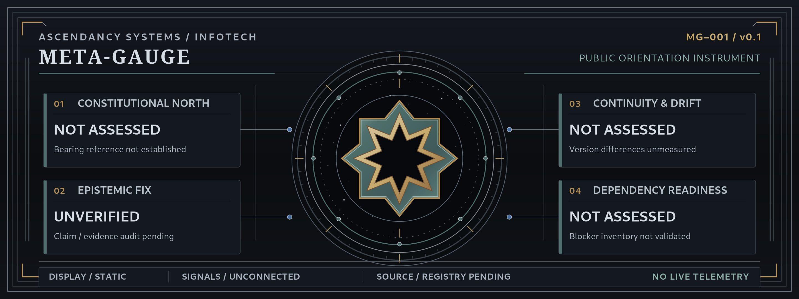

# Ascendancy Systems
***

**Independent Research** • **Knowledge Architecture** • **Systems Theory** • **Cognitive Technologies**

***

###### _The Institution_


***
```

```

## I. Orientation

Ascendancy Systems is an independent research and development program concerned with the architecture of knowledge, cognition, complex systems, and the relationships between theoretical inquiry and technological implementation.

The program investigates how knowledge is constituted, structured, related, represented, and made operative—across theoretical, computational, and human domains.

Our work spans foundational research, interdisciplinary frameworks, knowledge infrastructure, and experimental computational systems.

***

###### _The Structure_


***

## II. Fields of Inquiry

Ascendancy Systems develops research across several intersecting domains:

**Knowledge Architecture**

> The organization, representation, navigation, and integration of knowledge across conceptual and computational environments.

**Systems Theory & Cybernetics**

> The investigation of recursive, relational, regulatory, and complex systems, including their foundational principles and architectures.

**Cognition & Perception**

> The study of cognition, perception, interpretation, and the relationships between human understanding and constructed systems.

**Interface & Cognitive Technologies**

> The development and exploration of interfaces, AI-assisted knowledge environments, and experimental technologies connecting theoretical architecture with practical implementation.

These domains are interdependent, though each retains its own questions, methods, and developmental trajectory.

***

###### _The Observatory_


***

## III. Research & Development

Ascendancy Systems conducts interdisciplinary research across a continuum of theoretical, architectonic, semantic, and technological inquiry.

The following fields represent principal directions of investigation and development. Their relationships are often recursive and interdisciplinary; the groupings presented here serve as an orientation to the research program rather than a finalized taxonomy.

### Foundations & Ethics
Perceptual, regulative, and normative inquiry

> Inquiry into perception, ethical regulation, normative relations, and the principles through which cognitive and systemic activity may be understood and evaluated.

- _Perceptual Ethics_
- _Regulative Ethics_

### Systems & Dynamics
Cybernetics, paradox, and systemic relations

> The investigation of systemic relationships, recursive organization, paradox, and the dynamics of interconnected structures.

- _Latticeal Cybernetics_,
- _Paradox Network Systems Theory_

### Architectonics & Knowledge Architecture
Structural frameworks and architectures of cognition and experience

> Research concerned with the constitution, organization, relation, and interaction of architectures across knowledge, cognition, and experience.

- Architectonics
- Knowledge Architecture
- _Interface Architecture_
- Emotional Architecture
- Psychospatial Architecture

### Semantics, Poetics & Embodiment
Meaning, expression, aesthetic form, and registers

> Inquiry into meaning, interpretation, aesthetic expression, and the articulation of experience through semantic and poetic structures.

- __Field Semantics__
- _Aesthetic Poetics_
- Custodial-Architectonic Registers
- Various Poetics

### Governance & Meta-Architecture
Recursive governance and institutional structures

> The investigation and development of governing structures, recursive coordination, and the institutional organization of complex systems.

- Governing Architecture
- Recursive Governance
- Institutes and Institutions

### Research Infrastructure & Experimentation
Vaults, repositories, field notes, and empirical work

> The instruments, environments, and practices supporting research, documentation, investigation, and technological development.

- Obsidian Vaults
- Field Notes
- Research & Empirics
- Repositories

***

###### _The Threshold_


## IV. Development Status

The Ascendancy Research Program is under __active development__. 

Its research encompasses foundational manuscripts, theoretical frameworks, architectural specifications, and emerging technological experiments.

Research publications, technical projects, and supporting resources will be introduced progressively as they become ready for public presentation.

The public presence of Ascendancy Systems represents a developing expression of a larger body of ongoing work.

***

```
```


***


###### _The Meta-Gauge — Public Orientation Instrument_



_An instrument of orientation, evidence, continuity, and dependency awareness._

<sub>MG-001 · v0.1 — Static public display. Signal sources not yet connected.</sub>

[View the vector instrument](./assets/meta-gauge-v0.1.svg)


***


```
```

***

## V. Public Presence

### **Website**

[ascendancy.systems](https://ascendancy.systems) — _Under development_

### **GitHub**

[Ascendancy-Systems](https://www.github.com/Ascendancy-Systems) — Research and development repositories

Additional publication channels may be introduced as the program develops.

```

```
***

###### _Continuity_


## VI. Stewardship:

### _Constitutional Architect_ & _Steward_:

**Neodoxent** — neodoxent@ascendancy.systems

> Stewardship of Ascendancy Systems encompasses the continuity of its research, the integrity of its developing architecture, and the preservation and responsible advancement of its intellectual and technological works.

***
```


```
***

_Architecture establishes the conditions of inquiry; inquiry extends beyond the architecture that presently contains it_.

###### _The Pillars, the Doorway, the Starfield, and the Double Star_


_Ascendancy Systems_ — _Independent Research & Development_

___Ascendancy___
> Meta-Civilizational Framework Architecture
> 
> A Recursive Meaning-Operating Environment
